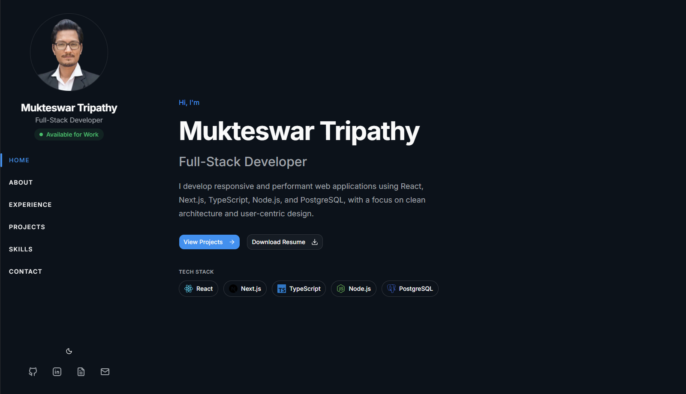

# Mukteswar Portfolio


A modern, responsive portfolio website showcasing my projects, skills, and experience as a Full-Stack Developer. Built with Next.js, React, TypeScript, and Tailwind CSS with a focus on performance, accessibility, and clean architecture.

## 🌐 Live Demo

**Website:** <https://mukteswar.me>

---

## 📸 Preview



---

Built with modern web technologies and designed to provide a fast, accessible, and engaging user experience across all devices.

## ✨ Features

- Responsive design for desktop, tablet, and mobile
- Dark & Light theme with system preference support
- Smooth scrolling navigation
- Active navigation (Scroll Spy)
- Modern animations with Motion
- SEO optimized
- Accessible UI
- Performance optimized
- Sitemap & robots.txt
- Open Graph & Twitter metadata

---

## 🛠 Tech Stack

### Frontend

- Next.js
- React
- TypeScript
- Tailwind CSS

### UI & Animation

- Motion
- Lucide React
- Base UI

### Development

- pnpm
- ESLint
- Prettier

### Deployment

- Vercel

---

## 🚀 Getting Started

Clone the repository:

```bash
git clone https://github.com/mukteswar-git/portfolio.git
```

Install dependencies:

```bash
pnpm install
```

Start the development server:

```bash
pnpm dev
```

Open:

```
http://localhost:3000
```

---

## 📦 Production Build

```bash
pnpm build
pnpm start
```

---

## 📂 Project Structure

```text
app/
components/
├── animations/
├── common/
├── layout/
├── sections/
├── theme/
├── ui/
hooks/
lib/
public/
```

---

## 📬 Contact

**Mukteswar Tripathy**

- 🌐 Website: https://mukteswar.me
- 💻 GitHub: https://github.com/mukteswar-git
- 📧 Email: mukteswart5@gmail.com
